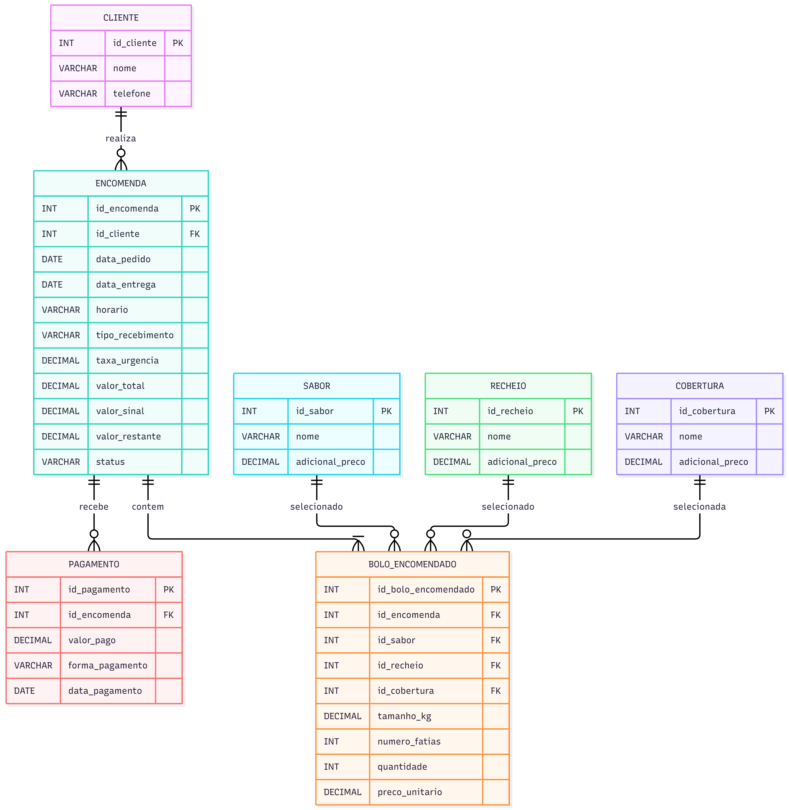

Neide é uma confeiteira, ela precisa de um sistema para gerenciar sua loja de roupa

Modelo Entidade-Relacionamento (MER) Entidades e atributos Cliente: armazena o nome e o telefone dos clientes. Encomenda: registra o cliente, a data do pedido, a data e o horário de entrega ou retirada, o tipo de recebimento, o valor total, a taxa de urgência, o sinal pago, o valor restante e o status. Bolo Encomendado: registra cada bolo do pedido, incluindo tamanho em quilogramas ou número de fatias, quantidade, sabor, recheio, cobertura e preço unitário. Sabor: armazena os sabores disponíveis e seus possíveis adicionais de preço. Recheio: armazena os recheios disponíveis e seus possíveis adicionais de preço. Cobertura: armazena as coberturas disponíveis e seus possíveis adicionais de preço. Pagamento: registra os valores pagos, a forma de pagamento e a data do pagamento. Relacionamentos Um cliente pode realizar várias encomendas (1:N). Uma encomenda pode conter vários bolos encomendados (1:N). Um sabor pode ser selecionado em vários bolos encomendados (1:N). Um recheio pode ser selecionado em vários bolos encomendados (1:N). Uma cobertura pode ser selecionada em vários bolos encomendados (1:N). Uma encomenda pode possuir vários registros de pagamento (1:N). Regras de negócio Encomendas realizadas com menos de 24 horas de antecedência recebem acréscimo de 30% no valor. O valor total considera o tamanho e o sabor do bolo, podendo incluir adicionais de recheio e cobertura. O sistema registra o sinal pago e calcula o valor restante da encomenda. Cada encomenda deve registrar a data, o horário e se será entregue ou retirada. A interface deve ser simples, organizada e possuir letras grandes para facilitar a leitura. Diagrama Entidade-Relacionamento (DER) !Diagrama DER

## Diagrama DER

